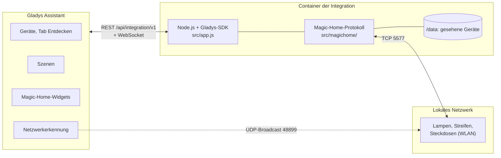
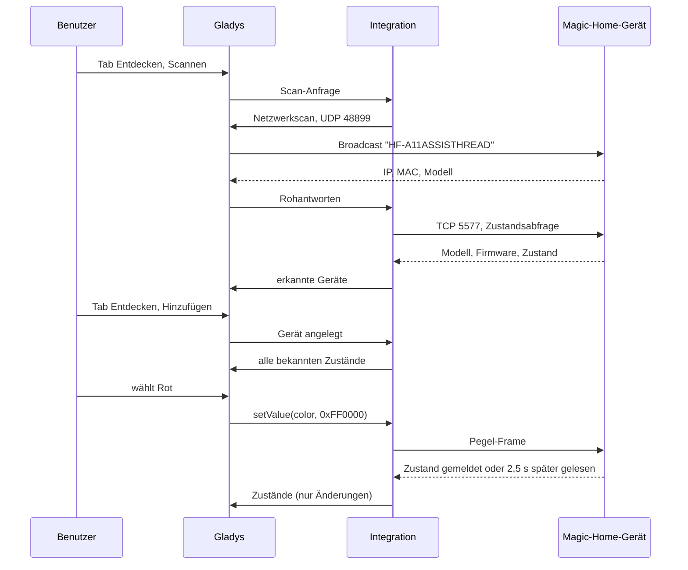
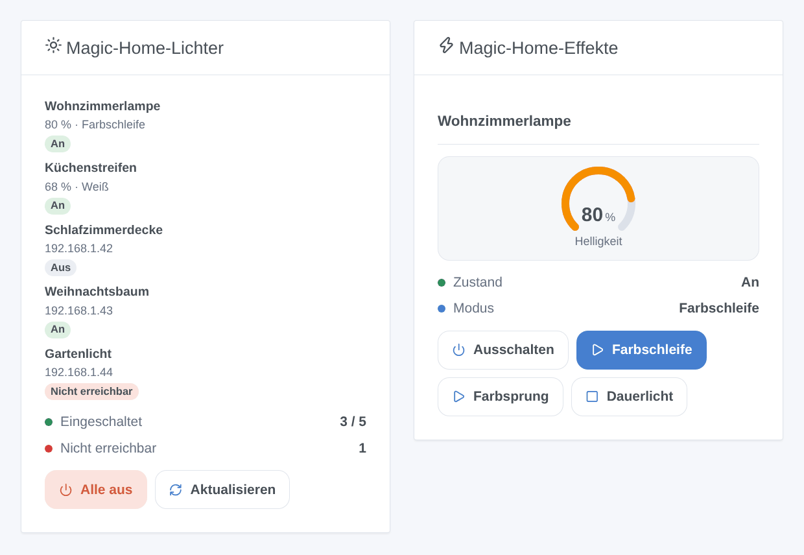

# Magic Home für Gladys Assistant

[English](README.md) | [Français](README.fr.md) | **Deutsch** | [Español](README.es.md)

[](LICENSE)
[](https://github.com/William-De71/gladys-magic-home/releases)
[](https://github.com/William-De71/gladys-magic-home/actions/workflows/release.yml)
[](https://gladysassistant.com)


Ihre Magic-Home-WLAN-Lampen, LED-Streifen-Controller und Steckdosen (Zengge-Firmwares: Apps Magic Home Pro, Zengge, Surplife) in Gladys Assistant, lokal im Netzwerk gesteuert, ohne Konto und ohne Cloud. Farben, Weißtöne, Helligkeit und eingebaute Effekte, im Dashboard und in den Szenen.

## Funktionen

- **Erkennung** im lokalen Netzwerk, ohne Konto: Die UDP-Suche der Magic-Home-App (Port 48899) läuft über die Netzwerkerkennung von Gladys; für Geräte, die sie nicht erreicht, lassen sich IP-Adressen eingeben. Jedes Gerät wird an seiner MAC-Adresse erkannt und nach einem Adresswechsel wiedergefunden.
- **Lichter** im Tab Entdecken mit den Funktionen, die Modell und Verdrahtung bieten: Ein/Aus, Helligkeit, Farbe, Farbtemperatur. Lampen, RGB- / RGBW- / RGBWW- / CCT- / einfarbige Controller, CCT-Lampen, adressierbare Streifen, Lichterketten.
- **Steckdosen und Schalter** als Ein/Aus-Schalter.
- **Alle Protokollgenerationen**: das ursprüngliche, die 8- und 9-Byte-Protokolle mit Prüfsumme, die 25-Byte-HSV-Firmware der neuesten Lampen, die gekapselten Frames der adressierbaren Streifen und Tischlampen.
- **Zustände** alle 10 s bis 1 min über eine Verbindung pro Gerät gelesen, dazu die Änderungen, die die Geräte selbst melden (Fernbedienung, Magic-Home-App), mit einem Badge lokal / nicht erreichbar pro Gerät.
- **Zwei Dashboard-Widgets**: „Magic-Home-Lichter“ (alle Geräte) und „Magic-Home-Effekte“ (ein Licht und drei Effekttasten).
- **Zwei Szenen-Auslöser** (ein Gerät antwortet nicht mehr, antwortet wieder) und **vier Szenen-Aktionen** (eingebauter Effekt, eigene Farben, Blinken, Effekt beenden).
- Englisch, Französisch, Deutsch und Spanisch.

## Funktionsweise




Der Container der Integration liegt hinter der Docker-Bridge, über die ein Broadcast nie ins Netzwerk gelangt: Gladys sendet im Host-Netzwerk das Suchdatagramm, das die Integration erzeugt, und leitet die Antworten weiter (`IP, MAC, Modell`). Die Integration öffnet dann pro Gerät eine TCP-Verbindung auf Port 5577, liest seinen Zustand und erkennt daraus Modell und Firmware, also Protokoll und Funktionen.




### Geräte und Funktionen

| Gerät                                                                            | Funktionen (Kategorie / Typ)                                           |
| -------------------------------------------------------------------------------- | ---------------------------------------------------------------------- |
| RGBCW-Lampen, Steh- und Deckenleuchten (Farbe oder Weiß)                         | Ein/Aus, Helligkeit (%), Farbe, Farbtemperatur (`light`)               |
| RGB&CCT- und RGB/CCT-Controller                                                  | Ein/Aus, Helligkeit, Farbe, Farbtemperatur                             |
| RGB-, RGBW-, RGB/W-Controller und -Lampen, adressierbare Streifen, Lichterketten | Ein/Aus, Helligkeit, Farbe (eine weiße Farbe schaltet die weißen LEDs) |
| CCT-Lampen und -Controller                                                       | Ein/Aus, Helligkeit, Farbtemperatur                                    |
| Einfarbige Controller und dimmbare Lampen                                        | Ein/Aus, Helligkeit                                                    |
| Steckdosen und Schalter                                                          | Ein/Aus (`switch` / `binary`)                                          |

Die Farbtemperatur ist in Mired (154 = 6500 K, 370 = 2700 K), der Skala des Gladys-Schiebereglers. Externe ID eines Geräts: `ext:<Selektor>:device:<MAC-Adresse>` (`ip-<Adresse>` für ein in der Konfiguration eingegebenes Gerät, das nie auf die Suche geantwortet hat); Funktionen: `…:power`, `…:brightness`, `…:color`, `…:temperature`.

## Transport

`transports: ["local"]`: Alles bleibt im lokalen Netzwerk, nichts verlässt es und kein Konto ist nötig. Jedes Gerät zeigt ein Badge **lokal** oder **nicht erreichbar**, wenn es nicht mehr antwortet (ausgesteckt, am Wandschalter aus, ohne WLAN). Es gibt keinen Cloud-Kanal, also keine Schaltfläche „Lokale Verbindung bevorzugen“. Der Fernzugriff der Magic-Home-App funktioniert daneben weiter: Die Integration ändert ihn nie.

## Widgets



- **Magic-Home-Lichter**: wie viele Geräte eingeschaltet sind und wie viele nicht antworten, jedes Gerät mit Zustands-Badge, Helligkeit und dem, was es spielt (Farbe, Weiß, Effektname), oder seiner Adresse, eine Schaltfläche **Alle aus** (mit Bestätigung) und **Aktualisieren**. Einstellung: alle Geräte oder nur eingeschaltete.
- **Magic-Home-Effekte**: ein in den Einstellungen gewähltes Licht: Zustand, Modus, eine Helligkeitsanzeige, eine Ein/Aus-Taste und drei in den Einstellungen gewählte Effekttasten (mit gemeinsamer Geschwindigkeit); während ein Effekt läuft, wird die dritte Taste zu **Dauerlicht**.

Die Bilder erzeugt `docs/illustrations/render.sh` aus dem echten Widget-Code: Es sind Illustrationen, keine Screenshots.

## Szenen-Auslöser und -Aktionen

| Auslöser        | Filter | Variablen           |
| --------------- | ------ | ------------------- |
| `light_offline` | Gerät  | `device_name`, `ip` |
| `light_online`  | Gerät  | `device_name`, `ip` |

`light_offline` löst aus, wenn ein Gerät 30 Sekunden lang nicht geantwortet hat (ein kurzer Ausfall löst nichts aus); `light_online`, wenn es nach einem `light_offline` wieder antwortet.

| Aktion          | Felder                                                             |
| --------------- | ------------------------------------------------------------------ |
| `start_effect`  | Gerät, Effekt (23 eingebaute Effekte), Geschwindigkeit, Helligkeit |
| `custom_effect` | Gerät, Farben (`#RRGGBB`, bis zu 16), Übergang, Geschwindigkeit    |
| `flash`         | Gerät, Farbe, Dauer (1 bis 60 s), danach vorheriger Zustand        |
| `stop_effect`   | Gerät: zurück zur letzten festen Farbe oder zum letzten Weiß       |

Keine liefert Ausgaben, und keine kann einen Auslöser auslösen. Beispiele:

- **Es klingelt an der Tür** → **Magic-Home-Licht blinken lassen** 5 s lang rot an der Wohnzimmerlampe, die danach in ihren vorherigen Zustand zurückkehrt.
- **Das Gartenlicht antwortet nicht mehr** (am Wandschalter aus) → „Das Gartenlicht ist am Schalter aus ({{triggerEvent.data.ip}})“ senden.
- Jeden Abend bei Sonnenuntergang → den Küchenstreifen auf 40 % einschalten, dann **Magic-Home-Farben abspielen** `#FF6A00, #FF0040` als langsames Überblenden am Wohnzimmerstreifen.

## Voraussetzungen

- Gladys Assistant **5.1.1 oder neuer** (Dashboard-Widgets sowie Szenen-Auslöser und -Aktionen von Integrationen; ältere Instanzen können die Integration nicht installieren).
- Mit der App Magic Home Pro (oder Zengge, Surplife…) eingerichtete Geräte im selben Netzwerk wie Gladys; der Router muss UDP-Port 48899 und TCP-Port 5577 zwischen ihnen durchlassen (kein Gastnetz, keine Client-Isolierung).
- Eine feste IP-Adresse pro Gerät im Router wird empfohlen (die Integration findet ein Gerät mit neuer Adresse wieder, mit fester Adresse aber schneller).

## Installation

- **Aus dem Store**: Integrationen → „Magic Home“ suchen → Installieren. Erlauben Sie auf dem Installationsbildschirm die Netzwerkerkennung (UDP-Port 48899).
- **Über die Repository-URL**: Integrationen → Integration installieren → `https://github.com/William-De71/gladys-magic-home` einfügen.
- **Entwicklermodus**: Integrationen → Integration installieren → Entwicklermodus, mit dem Manifest eines Builds (die Zusammenfassung des Workflows „Build and publish image“ zeigt es).

## Konfiguration

| Feld              | Typ    | Standard | Bedeutung                                                                  |
| ----------------- | ------ | -------- | -------------------------------------------------------------------------- |
| `hosts`           | string | leer     | IP-Adressen von Geräten, die die Suche nicht findet, durch Kommas getrennt |
| `poll_interval`   | select | `30`     | Zustandsaktualisierung in Sekunden: `10`, `30`, `60`                       |
| `rescan_interval` | select | `60`     | automatische Suche in Minuten: `0` (aus), `15`, `60`                       |
| `language`        | select | `en`     | Sprache der Funktionsnamen und der Fehlermeldungen der Szenen              |

Schaltfläche der Konfigurationsseite: **Geräte suchen und testen** (durchsucht das Netzwerk und listet jedes Gerät mit Adresse, Modell und Erreichbarkeit auf).

## Verwendung

1. Installieren Sie die Integration und drücken Sie dann auf ihrer Konfigurationsseite **Geräte suchen und testen**.
2. Fügen Sie die Geräte über den Tab **Entdecken** hinzu und benennen Sie sie nach Wunsch um.
3. Fügen Sie die Widgets einem Dashboard hinzu und erstellen Sie Ihre Szenen.

Die Benutzerdokumentation finden Sie in [docs/de.md](docs/de.md) ([en](docs/en.md), [fr](docs/fr.md), [es](docs/es.md)).

## Grenzen

- Geschrieben nach der Protokolldokumentation der freien Bibliothek [flux_led](https://github.com/lightinglibs/flux_led) (genutzt von der Home-Assistant-Integration „Magic Home“) und gegen byteweise simulierte Geräte getestet, **noch nicht gegen echte Geräte**: Rückmeldungen sind willkommen.
- Effekte: die 20 eingebauten Effekte der RGB-Controller und -Lampen (plus 3 auf neueren Firmwares) und eigene Farbschleifen. Die Hunderte Animationen adressierbarer Streifen und Lichterketten, der Musikmodus, Timer, Zonen und die Streifeneinstellungen (LED-Anzahl, IC-Typ, Verdrahtung) werden nicht unterstützt: Verwenden Sie dafür die Magic-Home-App.
- Die Helligkeit eines Effekts ist nur bei Firmwares mit dimmbaren Effekten einstellbar; die anderen spielen Effekte mit voller Helligkeit.
- Farbe und Weiß sind Alternativen: Die Integration schaltet jeweils eine LED-Gruppe, wie die App bei Lampen. Eine graue Farbe an ein RGB+W-Gerät schaltet seine weißen LEDs.
- Mehrkanalschalter (2 oder 4 Ausgänge) erscheinen als ein einziger Schalter.
- Geräte, die nur über die Cloud der Magic-Home-App erreichbar sind, werden nicht unterstützt.

## Lokale Entwicklung

```bash
npm install
GLADYS_HOST_API_URL=http://localhost:1443 \
  GLADYS_INTEGRATION_TOKEN=… GLADYS_INTEGRATION_SELECTOR=… \
  MAGICHOME_DATA_DIR=./data DEBUG=gladys-integration-sdk node index.js
```

| Variable                                                                         | Standard           | Verwendung                                |
| -------------------------------------------------------------------------------- | ------------------ | ----------------------------------------- |
| `GLADYS_HOST_API_URL`, `GLADYS_INTEGRATION_TOKEN`, `GLADYS_INTEGRATION_SELECTOR` | von Gladys gesetzt | Verbindung zur Host-API von Gladys        |
| `MAGICHOME_DATA_DIR`                                                             | `/data`            | Ordner von `devices.json`                 |
| `DEBUG`                                                                          | nicht gesetzt      | `gladys-integration-sdk` für die SDK-Logs |

| Skript                            | Funktion                                 |
| --------------------------------- | ---------------------------------------- |
| `npm test`                        | die Tests (`node --test`), ohne Netzwerk |
| `npm run lint`                    | ESLint                                   |
| `npm run format` / `format:check` | Prettier                                 |
| `docs/illustrations/render.sh`    | erzeugt die Widget-Illustrationen neu    |
| `scripts/build-cover.sh`          | erzeugt `cover.jpg` aus `cover.svg` neu  |

## Tests

`npm test` lässt die ganze Integration gegen das Fake-Gladys des SDK und simulierte Magic-Home-Geräte laufen, die mit echten Frames antworten (RGBCW-Lampe, CCT-Lampe, Steckdose, RGB-Controller, alter Controller, 25-Byte-Lampe): Erkennung per Broadcast und per Adresse, Protokollerkennung, Zustände, Befehle und ihre genauen Frames, von den Geräten gemeldete Zustände, Szenen-Auslöser und -Aktionen, mit `validateWidgetContent` geprüfte Widgets, Adresswechsel und Neustarts. Die Frame-Erzeuger und -Leser werden gegen an echten Geräten mitgeschnittene Frames geprüft. Jedes Modell wird gegen die Regeln des Gladys-Kerns und eine Erkennungsreferenz geprüft (externe IDs sind ewig), das Manifest gegen den Code, dazu die Übersetzungen und das Release-Skript. Die CI baut auch das Image und startet es wie Gladys (schreibgeschützt, 256 MB, ohne Netzwerk).

## Release-Prozess

Jeder Merge auf `main` veröffentlicht eine Version, wenn seine Commits es rechtfertigen, ohne manuellen Schritt:


- `feat` → Minor, `fix` / `perf` → Patch, `!` oder `BREAKING CHANGE:` → Major (ein Minor unter 1.0.0). `docs`, `chore`, `ci`, `test`, `style`, `refactor`, `build` allein veröffentlichen nichts.
- Der Titel des Pull Requests wird zum Squash-Commit, also zur Changelog-Zeile: auf Englisch und für die Nutzer schreiben (`feat(effects): …`). `pr-title.yml` prüft ihn. `CHANGELOG.md` nie von Hand bearbeiten.
- Das Image existiert, bevor `main` seine Version ankündigt (der Store indiziert `main`).
- 1.0.0 ist eine manuelle Entscheidung: Actions → Release → Run workflow, `release-as: 1.0.0`. `dry-run` zeigt Version und Changelog, ohne zu veröffentlichen.
- **Geschütztes `main`**: Die Release pusht einen Commit auf `main`. Mit Branch-Schutz oder Ruleset GitHub Actions die Umgehung erlauben (oder eine GitHub App nutzen), sonst stoppt die Release nach dem Image.
- Nach der ersten Release das Paket öffentlich machen: Package settings → Change visibility → Public.

## Fehlerbehebung

- **Kein Gerät gefunden**: Prüfen Sie, ob das Gerät in der Magic-Home-App über WLAN antwortet (nicht nur über die Cloud), im selben Netzwerk wie Gladys ist und der Router WLAN-Clients nicht isoliert. Andernfalls geben Sie seine IP-Adresse in der Konfiguration ein.
- **„Gladys hat die Netzwerkerkennung abgelehnt“**: Installieren Sie die Integration neu und erlauben Sie auf dem Installationsbildschirm ihren Netzwerkzugriff.
- **Ein Gerät ist „Nicht erreichbar“**: Es ist ausgesteckt, am Wandschalter aus oder ohne WLAN. Hat sich seine Adresse geändert, findet die nächste Suche es wieder (automatisch oder **Geräte suchen und testen**).
- **Eine Funktion fehlt oder ist falsch**: Die Funktionen folgen Modell und Verdrahtung, die das Gerät meldet; eröffnen Sie ein Issue mit dem Geräteparameter `MAGICHOME_MODEL` und den Logs.
- Logs: der Tab Logs der Integration; `DEBUG=gladys-integration-sdk` für die SDK-Details.

## Mitwirken

Issues und Pull Requests sind willkommen. Führen Sie `npm run format:check`, `npm run lint` und `npm test` aus, schreiben Sie den Titel des Pull Requests als Conventional Commit und führen Sie nach jeder Änderung eines Widget-Inhalts `docs/illustrations/render.sh` aus. Ein neues Modell gehört in `src/magichome/models.js`; es darf die Funktionen eines bestehenden Modells nicht ändern (`test/fixtures/discovery.baseline.json`).

## Sicherheit

Siehe [SECURITY.md](SECURITY.md). Kein Konto, kein Passwort, kein Token: Die Integration spricht nur mit den Geräten Ihres lokalen Netzwerks. `/data` enthält Adresse und Modell jedes gesehenen Geräts.

## Lizenz

[Apache-Lizenz 2.0](LICENSE), siehe auch [NOTICE](NOTICE). Das Protokoll ist für dieses Projekt implementiert, mit der Bibliothek [flux_led](https://github.com/lightinglibs/flux_led) als Dokumentation. Magic Home, Zengge und Surplife sind Marken ihrer Inhaber; dieses Projekt ist nicht mit ihnen verbunden und wird von ihnen weder unterstützt noch gebilligt.
