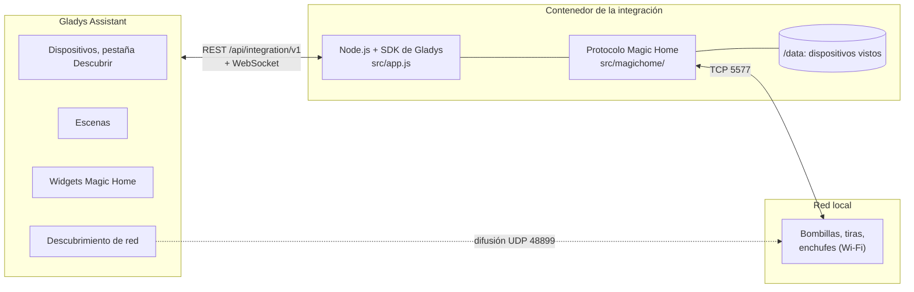
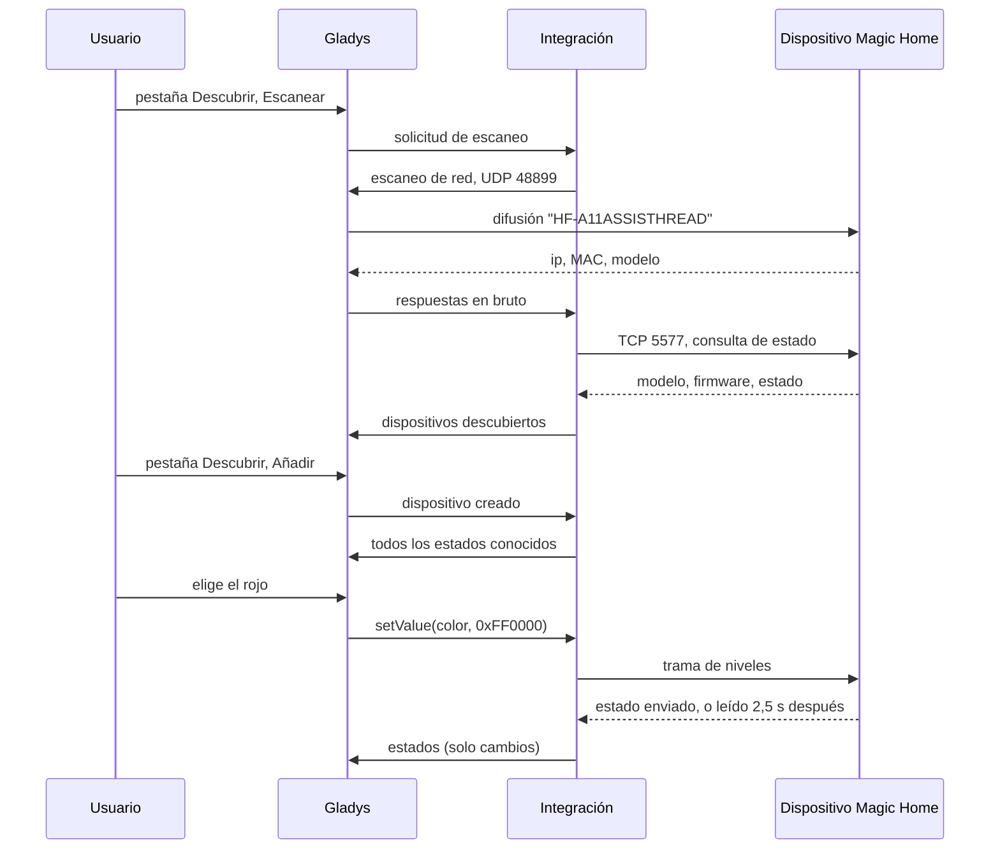
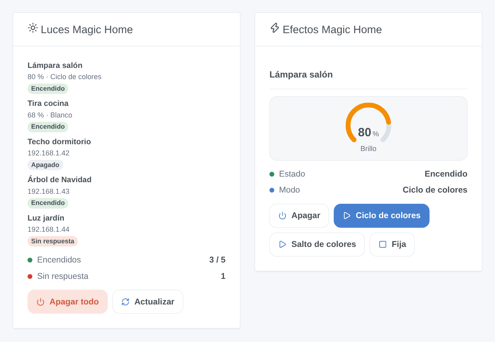

# Magic Home para Gladys Assistant

[English](README.md) | [Français](README.fr.md) | [Deutsch](README.de.md) | **Español**

[](LICENSE)
[](https://github.com/William-De71/gladys-magic-home/releases)
[](https://github.com/William-De71/gladys-magic-home/actions/workflows/release.yml)
[](https://gladysassistant.com)


Sus bombillas, controladores de tiras LED y enchufes Wi-Fi Magic Home (firmwares Zengge: apps Magic Home Pro, Zengge, Surplife) en Gladys Assistant, controlados en su red local, sin cuenta ni nube. Colores, blancos, brillo y efectos integrados, en el panel y en las escenas.

## Funciones

- **Descubrimiento** en la red local, sin ninguna cuenta: la búsqueda UDP de la app Magic Home (puerto 48899) pasa por el descubrimiento de red de Gladys; puede introducir la dirección IP de los dispositivos que no alcanza. Cada dispositivo se identifica por su dirección MAC y se vuelve a encontrar tras un cambio de dirección.
- **Luces** en la pestaña Descubrir con las funciones que permiten su modelo y su cableado: encendido/apagado, brillo, color, temperatura de color. Bombillas, controladores RGB / RGBW / RGBWW / CCT / monocolor, bombillas CCT, tiras direccionables, guirnaldas.
- **Enchufes e interruptores** como interruptores de encendido/apagado.
- **Todas las generaciones del protocolo**: el original, los protocolos de 8 y 9 bytes con suma de control, el firmware HSV de 25 bytes de las bombillas más recientes, las tramas encapsuladas de las tiras direccionables y las lámparas de mesa.
- **Estados** leídos cada 10 s a 1 min por una sola conexión por dispositivo, más los cambios que los dispositivos comunican por sí mismos (mando a distancia, app Magic Home), con una insignia local / sin respuesta por dispositivo.
- **Dos widgets de panel**: «Luces Magic Home» (todos los dispositivos) y «Efectos Magic Home» (una luz y tres botones de efecto).
- **Dos disparadores de escena** (un dispositivo deja de responder, vuelve a responder) y **cuatro acciones de escena** (efecto integrado, colores personalizados, parpadeo, detener el efecto).
- Inglés, francés, alemán y español.

## Funcionamiento




El contenedor de la integración está detrás del puente Docker, donde una difusión nunca llega a la red: Gladys, en la red del host, difunde el datagrama de búsqueda que crea la integración y le reenvía las respuestas (`ip, MAC, modelo`). La integración abre después una conexión TCP por dispositivo en el puerto 5577, lee su estado y deduce de él su modelo y su firmware, es decir, su protocolo y sus funciones.




### Dispositivos y funciones

| Dispositivo                                                                  | Funciones (categoría / tipo)                                          |
| ---------------------------------------------------------------------------- | --------------------------------------------------------------------- |
| Bombillas RGBCW, lámparas de pie y de techo (color o blanco)                 | Encendido/apagado, Brillo (%), Color, Temperatura de color (`light`)  |
| Controladores RGB&CCT y RGB/CCT                                              | Encendido/apagado, Brillo, Color, Temperatura de color                |
| Controladores y bombillas RGB, RGBW, RGB/W, tiras direccionables, guirnaldas | Encendido/apagado, Brillo, Color (un blanco enciende los LED blancos) |
| Bombillas y controladores CCT                                                | Encendido/apagado, Brillo, Temperatura de color                       |
| Controladores monocolor y bombillas regulables                               | Encendido/apagado, Brillo                                             |
| Enchufes e interruptores                                                     | Encendido/apagado (`switch` / `binary`)                               |

La temperatura de color está en mired (154 = 6500 K, 370 = 2700 K), la escala del control deslizante de Gladys. Identificador externo de un dispositivo: `ext:<selector>:device:<dirección MAC>` (`ip-<dirección>` para un dispositivo introducido en la configuración que nunca respondió a la búsqueda); funciones: `…:power`, `…:brightness`, `…:color`, `…:temperature`.

## Transporte

`transports: ["local"]`: todo se queda en su red local, nada sale de ella y no hace falta ninguna cuenta. Cada dispositivo muestra una insignia **local**, o **sin respuesta** cuando deja de responder (desenchufado, apagado en el interruptor, sin Wi-Fi). No hay canal en la nube, así que no hay botón «Preferir la conexión local». El acceso remoto de la app Magic Home sigue funcionando en paralelo: la integración nunca lo modifica.

## Widgets



- **Luces Magic Home**: cuántos dispositivos están encendidos y cuántos no responden, cada dispositivo con su insignia de estado, su brillo y lo que reproduce (color, blanco, nombre del efecto) o su dirección, un botón **Apagar todo** (con confirmación) y **Actualizar**. Ajuste: todos los dispositivos o solo los encendidos.
- **Efectos Magic Home**: una luz elegida en los ajustes: estado, modo, un indicador de brillo, un botón de encendido/apagado y tres botones de efecto elegidos en los ajustes (con una velocidad común); mientras se reproduce un efecto, el tercer botón pasa a ser **Fija**.

Las imágenes las genera `docs/illustrations/render.sh` a partir del código real de los widgets: son ilustraciones, no capturas de pantalla.

## Disparadores y acciones de escena

| Disparador      | Filtros     | Variables           |
| --------------- | ----------- | ------------------- |
| `light_offline` | dispositivo | `device_name`, `ip` |
| `light_online`  | dispositivo | `device_name`, `ip` |

`light_offline` se dispara cuando un dispositivo lleva 30 segundos sin responder (un corte breve no dispara nada); `light_online` cuando vuelve a responder después de un `light_offline`.

| Acción          | Campos                                                              |
| --------------- | ------------------------------------------------------------------- |
| `start_effect`  | dispositivo, efecto (23 efectos integrados), velocidad, brillo      |
| `custom_effect` | dispositivo, colores (`#RRGGBB`, hasta 16), transición, velocidad   |
| `flash`         | dispositivo, color, duración (1 a 60 s), y luego el estado anterior |
| `stop_effect`   | dispositivo: vuelve al último color o blanco fijo                   |

Ninguna devuelve salidas y ninguna puede activar un disparador. Ejemplos:

- **Alguien llama a la puerta** → **Hacer parpadear una luz Magic Home** en rojo 5 s en la lámpara del salón, que luego vuelve a su estado anterior.
- **La luz del jardín deja de responder** (apagada en el interruptor) → enviar «La luz del jardín está apagada en el interruptor ({{triggerEvent.data.ip}})».
- Cada tarde al atardecer → encender la tira de la cocina al 40 % y luego **Reproducir colores Magic Home** `#FF6A00, #FF0040` en fundido lento en la tira del salón.

## Requisitos

- Gladys Assistant **5.1.1 o posterior** (widgets de panel y disparadores y acciones de escena de las integraciones; las instancias más antiguas no pueden instalar la integración).
- Dispositivos configurados con la app Magic Home Pro (o Zengge, Surplife…), conectados a la misma red que Gladys; el router debe dejar pasar el puerto UDP 48899 y el puerto TCP 5577 entre ellos (sin red de invitados ni aislamiento de clientes).
- Se recomienda una dirección IP fija por dispositivo en el router (la integración encuentra un dispositivo que cambió de dirección, pero antes con una dirección fija).

## Instalación

- **Desde la tienda**: Integraciones → buscar «Magic Home» → Instalar. Acepte el descubrimiento de red (puerto UDP 48899) en la pantalla de instalación.
- **Desde la URL del repositorio**: Integraciones → Instalar una integración → pegar `https://github.com/William-De71/gladys-magic-home`.
- **Modo desarrollador**: Integraciones → Instalar una integración → Modo desarrollador, con el manifiesto de una compilación (el resumen del workflow «Build and publish image» lo muestra).

## Configuración

| Campo             | Tipo   | Por defecto | Significado                                                                          |
| ----------------- | ------ | ----------- | ------------------------------------------------------------------------------------ |
| `hosts`           | string | vacío       | direcciones IP de los dispositivos que la búsqueda no encuentra, separadas por comas |
| `poll_interval`   | select | `30`        | actualización del estado en segundos: `10`, `30`, `60`                               |
| `rescan_interval` | select | `60`        | búsqueda automática en minutos: `0` (desactivada), `15`, `60`                        |
| `language`        | select | `en`        | idioma de los nombres de las funciones y de los mensajes de error de las escenas     |

Botón de la página de configuración: **Buscar y probar los dispositivos** (busca en la red y lista cada dispositivo con su dirección, su modelo y si responde).

## Uso

1. Instale la integración y pulse **Buscar y probar los dispositivos** en su página de configuración.
2. Añada los dispositivos desde la pestaña **Descubrir** y renómbrelos a su gusto.
3. Añada los widgets a un panel y cree sus escenas.

La documentación de usuario está en [docs/es.md](docs/es.md) ([en](docs/en.md), [fr](docs/fr.md), [de](docs/de.md)).

## Límites

- Escrita a partir de la documentación del protocolo de la biblioteca libre [flux_led](https://github.com/lightinglibs/flux_led) (usada por la integración «Magic Home» de Home Assistant) y probada contra dispositivos simulados byte a byte, **aún no contra dispositivos reales**: se agradecen los comentarios.
- Efectos: los 20 efectos integrados de los controladores y bombillas RGB (y 3 más en los firmwares recientes) y los bucles de colores personalizados. Los cientos de animaciones de las tiras direccionables y las guirnaldas, el modo música, los temporizadores, las zonas y los ajustes de las tiras (número de LED, tipo de chip, cableado) no se gestionan: use la app Magic Home para ello.
- El brillo de un efecto solo se puede ajustar en los firmwares con efectos regulables; los demás reproducen los efectos a pleno brillo.
- Un color y un blanco son alternativas: la integración enciende un grupo de LED a la vez, como hace la app en las bombillas. Un color gris enviado a un dispositivo RGB+W enciende sus LED blancos.
- Los interruptores multicanal (2 o 4 salidas) se ven como un solo interruptor.
- Los dispositivos accesibles solo a través de la nube de la app Magic Home no son compatibles.

## Desarrollo local

```bash
npm install
GLADYS_HOST_API_URL=http://localhost:1443 \
  GLADYS_INTEGRATION_TOKEN=… GLADYS_INTEGRATION_SELECTOR=… \
  MAGICHOME_DATA_DIR=./data DEBUG=gladys-integration-sdk node index.js
```

| Variable                                                                         | Por defecto       | Uso                                            |
| -------------------------------------------------------------------------------- | ----------------- | ---------------------------------------------- |
| `GLADYS_HOST_API_URL`, `GLADYS_INTEGRATION_TOKEN`, `GLADYS_INTEGRATION_SELECTOR` | las define Gladys | conexión a la API host de Gladys               |
| `MAGICHOME_DATA_DIR`                                                             | `/data`           | carpeta de `devices.json`                      |
| `DEBUG`                                                                          | sin definir       | `gladys-integration-sdk` para los logs del SDK |

| Script                            | Qué hace                                     |
| --------------------------------- | -------------------------------------------- |
| `npm test`                        | las pruebas (`node --test`), sin red         |
| `npm run lint`                    | ESLint                                       |
| `npm run format` / `format:check` | Prettier                                     |
| `docs/illustrations/render.sh`    | regenera las ilustraciones de los widgets    |
| `scripts/build-cover.sh`          | regenera `cover.jpg` a partir de `cover.svg` |

## Pruebas

`npm test` ejecuta toda la integración contra el Gladys falso del SDK y dispositivos Magic Home simulados que responden con las tramas reales (bombilla RGBCW, bombilla CCT, enchufe, controlador RGB, controlador antiguo, bombilla de 25 bytes): descubrimiento por difusión y por dirección, detección del protocolo, estados, órdenes y sus tramas exactas, estados enviados por los dispositivos, disparadores y acciones de escena, widgets validados por `validateWidgetContent`, cambios de dirección y reinicios. Los generadores y lectores de tramas se comprueban con tramas capturadas en dispositivos reales. Cada modelo se comprueba con las reglas del núcleo de Gladys y una referencia de descubrimiento (los identificadores externos son para siempre), el manifiesto con el código, además de las traducciones y el script de publicación. La CI también construye la imagen y la arranca como Gladys (solo lectura, 256 MB, sin red).

## Proceso de publicación

Cada fusión en `main` publica una versión cuando sus commits lo justifican, sin ningún paso manual:

```mermaid
flowchart LR
  A[fusión en main] --> B[CI: Prettier, ESLint,<br/>pruebas, build Docker]
  B --> C[siguiente versión según<br/>los Conventional Commits]
  C --> D[sección de CHANGELOG.md]
  D --> E[commit chore release<br/>+ tag vX.Y.Z]
  E --> F[imagen :X.Y.Z + :latest<br/>amd64 + arm64]
  F --> G[main avanza al<br/>commit de publicación]
  G --> H[GitHub Release]
  H --> I[verificación: pull anónimo,<br/>validador de la tienda, topic]
```




- `feat` → menor, `fix` / `perf` → parche, `!` o `BREAKING CHANGE:` → mayor (una menor antes de 1.0.0). `docs`, `chore`, `ci`, `test`, `style`, `refactor`, `build` solos no publican nada.
- El título de la pull request se convierte en el commit de fusión, es decir, en la línea del changelog: escríbalo en inglés y para el usuario (`feat(effects): …`). `pr-title.yml` lo comprueba. Nunca edite `CHANGELOG.md` a mano.
- La imagen existe antes de que `main` anuncie su versión (la tienda indexa `main`).
- La 1.0.0 es una decisión manual: Actions → Release → Run workflow, `release-as: 1.0.0`. `dry-run` muestra la versión y el changelog sin publicar nada.
- **`main` protegida**: la publicación envía un commit a `main`. Con una protección de rama o un ruleset, permita que GitHub Actions la omita (o use una GitHub App); si no, la publicación se detiene tras la imagen.
- Tras la primera publicación, haga público el paquete: Package settings → Change visibility → Public.

## Solución de problemas

- **No se encuentra ningún dispositivo**: compruebe que el dispositivo responde en la app Magic Home por Wi-Fi (no solo a través de la nube), que está en la misma red que Gladys y que el router no aísla a los clientes Wi-Fi. Si no, introduzca su dirección IP en la configuración.
- **«Gladys rechazó el descubrimiento de red»**: reinstale la integración y acepte su acceso a la red en la pantalla de instalación.
- **Un dispositivo está «Sin respuesta»**: está desenchufado, apagado en el interruptor o sin Wi-Fi. Si su dirección cambió, la siguiente búsqueda lo vuelve a encontrar (automática, o **Buscar y probar los dispositivos**).
- **Falta una función o es incorrecta**: las funciones siguen el modelo y el cableado que anuncia el dispositivo; abra una issue con el parámetro de dispositivo `MAGICHOME_MODEL` y los logs.
- Logs: la pestaña Logs de la integración; `DEBUG=gladys-integration-sdk` para el detalle del SDK.

## Contribuir

Las issues y las pull requests son bienvenidas. Ejecute `npm run format:check`, `npm run lint` y `npm test`, escriba el título de la pull request como un Conventional Commit y vuelva a ejecutar `docs/illustrations/render.sh` tras cualquier cambio en el contenido de un widget. Un modelo nuevo va en `src/magichome/models.js`; no debe cambiar las funciones de un modelo existente (`test/fixtures/discovery.baseline.json`).

## Seguridad

Vea [SECURITY.md](SECURITY.md). Sin cuenta, sin contraseña y sin token: la integración solo habla con los dispositivos de su red local. `/data` contiene la dirección y el modelo de cada dispositivo visto.

## Licencia

[Licencia Apache 2.0](LICENSE), vea también [NOTICE](NOTICE). El protocolo está implementado para este proyecto, con la biblioteca [flux_led](https://github.com/lightinglibs/flux_led) como documentación. Magic Home, Zengge y Surplife son marcas de sus propietarios; este proyecto no está afiliado a ellos, ni respaldado ni apoyado por ellos.
