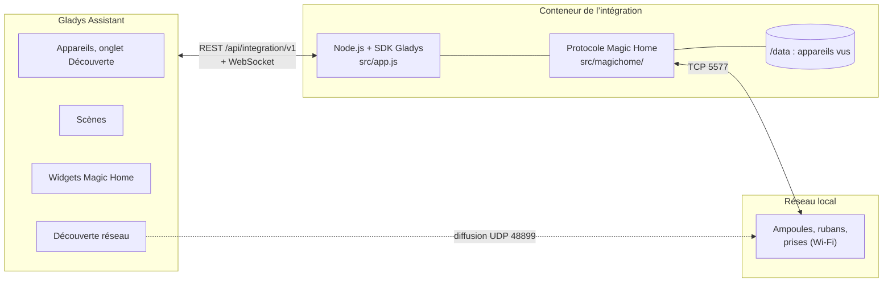
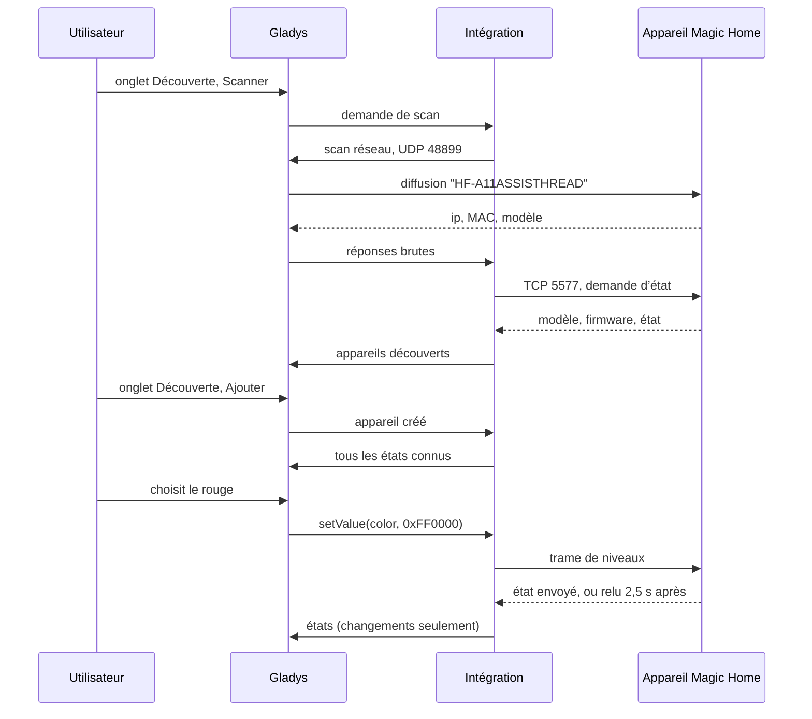
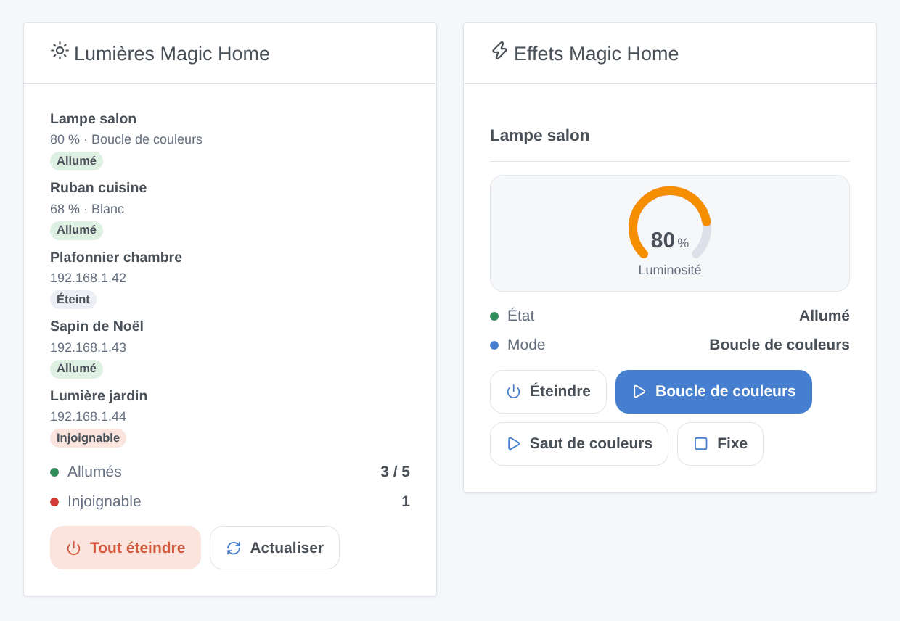

# Magic Home pour Gladys Assistant

[English](README.md) | **Français** | [Deutsch](README.de.md) | [Español](README.es.md)

[](LICENSE)
[](https://github.com/William-De71/gladys-magic-home/releases)
[](https://github.com/William-De71/gladys-magic-home/actions/workflows/release.yml)
[](https://gladysassistant.com)


Vos ampoules, contrôleurs de rubans LED et prises Wi-Fi Magic Home (firmwares Zengge : applications Magic Home Pro, Zengge, Surplife) dans Gladys Assistant, pilotés sur votre réseau local, sans compte ni cloud. Couleurs, blancs, luminosité et effets intégrés, sur le tableau de bord et dans les scènes.

## Fonctionnalités

- **Découverte** sur le réseau local, sans aucun compte : la recherche UDP de l’application Magic Home (port 48899) passe par la découverte réseau de Gladys ; vous pouvez saisir l’adresse IP des appareils qu’elle n’atteint pas. Chaque appareil est identifié par son adresse MAC et retrouvé après un changement d’adresse.
- **Lumières** dans l’onglet Découverte, avec les fonctionnalités que permettent leur modèle et leur câblage : marche/arrêt, luminosité, couleur, température de couleur. Ampoules, contrôleurs RGB / RGBW / RGBWW / CCT / monochromes, ampoules CCT, rubans adressables, guirlandes.
- **Prises et interrupteurs** comme interrupteurs marche/arrêt.
- **Toutes les générations du protocole** : l’original, les protocoles 8 et 9 octets avec somme de contrôle, le firmware 25 octets en HSV des ampoules récentes, les trames encapsulées des rubans adressables et des lampes de table.
- **États** lus toutes les 10 s à 1 min sur une seule connexion par appareil, plus les changements que les appareils signalent d’eux-mêmes (télécommande, application Magic Home), avec un badge local / injoignable par appareil.
- **Deux widgets de tableau de bord** : « Lumières Magic Home » (tous les appareils) et « Effets Magic Home » (une lumière et trois boutons d’effet).
- **Deux déclencheurs de scène** (un appareil ne répond plus, répond à nouveau) et **quatre actions de scène** (effet intégré, couleurs personnalisées, clignotement, arrêt de l’effet).
- Anglais, français, allemand et espagnol.

## Fonctionnement




Le conteneur de l’intégration est derrière le pont Docker, où une diffusion n’atteint jamais le réseau : Gladys, sur le réseau de l’hôte, diffuse le datagramme de recherche que l’intégration fabrique et lui relaie les réponses (`ip, MAC, modèle`). L’intégration ouvre ensuite une connexion TCP par appareil sur le port 5577, lit son état et en déduit son modèle et son firmware, donc son protocole et ses fonctionnalités.




### Appareils et fonctionnalités

| Appareil                                                                 | Fonctionnalités (catégorie / type)                                      |
| ------------------------------------------------------------------------ | ----------------------------------------------------------------------- |
| Ampoules RGBCW, lampadaires et plafonniers (couleur ou blanc)            | Marche/arrêt, Luminosité (%), Couleur, Température de couleur (`light`) |
| Contrôleurs RGB&CCT et RGB/CCT                                           | Marche/arrêt, Luminosité, Couleur, Température de couleur               |
| Contrôleurs et ampoules RGB, RGBW, RGB/W, rubans adressables, guirlandes | Marche/arrêt, Luminosité, Couleur (un blanc allume les LED blanches)    |
| Ampoules et contrôleurs CCT                                              | Marche/arrêt, Luminosité, Température de couleur                        |
| Contrôleurs monochromes et ampoules variables                            | Marche/arrêt, Luminosité                                                |
| Prises et interrupteurs                                                  | Marche/arrêt (`switch` / `binary`)                                      |

La température de couleur est en mired (154 = 6500 K, 370 = 2700 K), l’échelle du curseur de Gladys. Identifiant externe d’un appareil : `ext:<sélecteur>:device:<adresse MAC>` (`ip-<adresse>` pour un appareil saisi dans la configuration qui n’a jamais répondu à la recherche) ; fonctionnalités : `…:power`, `…:brightness`, `…:color`, `…:temperature`.

## Transport

`transports: ["local"]` : tout reste sur votre réseau local, rien n’en sort et aucun compte n’est nécessaire. Chaque appareil affiche un badge **local**, ou **injoignable** quand il ne répond plus (débranché, coupé à l’interrupteur, hors Wi-Fi). Il n’y a pas de canal cloud, donc pas de bouton « Préférer la connexion locale ». L’accès à distance de l’application Magic Home continue de fonctionner à côté : l’intégration n’y touche jamais.

## Widgets



- **Lumières Magic Home** : combien d’appareils sont allumés et combien ne répondent pas, chaque appareil avec son badge d’état, sa luminosité et ce qu’il joue (couleur, blanc, nom de l’effet) ou son adresse, un bouton **Tout éteindre** (avec confirmation) et **Actualiser**. Réglage : tous les appareils ou seulement ceux allumés.
- **Effets Magic Home** : une lumière choisie dans les réglages : état, mode, une jauge de luminosité, un bouton marche/arrêt et trois boutons d’effet choisis dans les réglages (avec une vitesse commune) ; pendant un effet, le troisième bouton devient **Fixe**.

Les images sont générées par `docs/illustrations/render.sh` à partir du vrai code des widgets : ce sont des illustrations, pas des captures d’écran.

## Déclencheurs et actions de scène

| Déclencheur     | Filtres  | Variables           |
| --------------- | -------- | ------------------- |
| `light_offline` | appareil | `device_name`, `ip` |
| `light_online`  | appareil | `device_name`, `ip` |

`light_offline` se déclenche quand un appareil n’a pas répondu pendant 30 secondes (une courte coupure ne déclenche rien) ; `light_online` quand il répond à nouveau après un `light_offline`.

| Action          | Champs                                                              |
| --------------- | ------------------------------------------------------------------- |
| `start_effect`  | appareil, effet (23 effets intégrés), vitesse, luminosité           |
| `custom_effect` | appareil, couleurs (`#RRVVBB`, jusqu’à 16), transition, vitesse     |
| `flash`         | appareil, couleur, durée (1 à 60 s), puis retour à l’état précédent |
| `stop_effect`   | appareil : retour à la dernière couleur ou au dernier blanc fixe    |

Aucune ne renvoie de sortie, et aucune ne peut déclencher un déclencheur. Exemples :

- **Quelqu’un sonne à la porte** → **Faire clignoter une lumière Magic Home** en rouge 5 s sur la lampe du salon, qui revient ensuite comme avant.
- **La lumière du jardin ne répond plus** (coupée à l’interrupteur) → envoyer « La lumière du jardin est coupée à l’interrupteur ({{triggerEvent.data.ip}}) ».
- Chaque soir au coucher du soleil → allumer le ruban de la cuisine à 40 %, puis **Jouer des couleurs Magic Home** `#FF6A00, #FF0040` en fondu lent sur le ruban du salon.

## Prérequis

- Gladys Assistant **5.1.1 ou plus récent** (widgets de tableau de bord et déclencheurs et actions de scène des intégrations ; les instances plus anciennes ne peuvent pas installer l’intégration).
- Des appareils installés avec l’application Magic Home Pro (ou Zengge, Surplife…), connectés au même réseau que Gladys ; la box doit laisser passer le port UDP 48899 et le port TCP 5577 entre eux (pas de réseau invité, pas d’isolation des clients).
- Une adresse IP fixe par appareil dans la box est recommandée (l’intégration retrouve un appareil qui a changé d’adresse, mais plus vite avec une adresse fixe).

## Installation

- **Depuis le store** : Intégrations → chercher « Magic Home » → Installer. Acceptez la découverte réseau (port UDP 48899) sur l’écran d’installation.
- **Depuis l’URL du dépôt** : Intégrations → Installer une intégration → coller `https://github.com/William-De71/gladys-magic-home`.
- **Mode développeur** : Intégrations → Installer une intégration → Mode développeur, avec le manifeste d’un build (le résumé du workflow « Build and publish image » l’affiche).

## Configuration

| Champ             | Type   | Défaut | Signification                                                                   |
| ----------------- | ------ | ------ | ------------------------------------------------------------------------------- |
| `hosts`           | string | vide   | adresses IP des appareils que la recherche ne trouve pas, séparées par virgules |
| `poll_interval`   | select | `30`   | actualisation de l’état en secondes : `10`, `30`, `60`                          |
| `rescan_interval` | select | `60`   | recherche automatique en minutes : `0` (désactivée), `15`, `60`                 |
| `language`        | select | `en`   | langue des noms de fonctionnalités et des messages d’erreur des scènes          |

Bouton de la page de configuration : **Rechercher et tester les appareils** (cherche sur le réseau et liste chaque appareil avec son adresse, son modèle et s’il répond).

## Utilisation

1. Installez l’intégration, puis appuyez sur **Rechercher et tester les appareils** dans sa page de configuration.
2. Ajoutez les appareils depuis l’onglet **Découverte**, et renommez-les à votre goût.
3. Ajoutez les widgets à un tableau de bord, créez vos scènes.

La documentation utilisateur est dans [docs/fr.md](docs/fr.md) ([en](docs/en.md), [de](docs/de.md), [es](docs/es.md)).

## Limites

- Écrite à partir de la documentation du protocole de la bibliothèque libre [flux_led](https://github.com/lightinglibs/flux_led) (utilisée par l’intégration « Magic Home » de Home Assistant), et testée contre des appareils simulés octet par octet, **pas encore contre de vrais appareils** : vos retours sont les bienvenus.
- Effets : les 20 effets intégrés des contrôleurs et ampoules RGB (et 3 de plus sur les firmwares récents) et les boucles de couleurs personnalisées. Les centaines d’animations des rubans adressables et des guirlandes, le mode musique, les minuteries, les zones et les réglages des rubans (nombre de LED, type de puce, câblage) ne sont pas gérés : utilisez l’application Magic Home pour cela.
- La luminosité d’un effet n’est réglable que sur les firmwares à effets variables ; les autres jouent les effets à pleine luminosité.
- Une couleur et un blanc sont des alternatives : l’intégration allume un groupe de LED à la fois, comme l’application sur les ampoules. Une couleur grise envoyée à un appareil RGB+W allume ses LED blanches.
- Les interrupteurs multicanaux (2 ou 4 sorties) sont vus comme un seul interrupteur.
- Les appareils joignables seulement par le cloud de l’application Magic Home ne sont pas pris en charge.

## Développement local

```bash
npm install
GLADYS_HOST_API_URL=http://localhost:1443 \
  GLADYS_INTEGRATION_TOKEN=… GLADYS_INTEGRATION_SELECTOR=… \
  MAGICHOME_DATA_DIR=./data DEBUG=gladys-integration-sdk node index.js
```

| Variable                                                                         | Défaut              | Usage                                         |
| -------------------------------------------------------------------------------- | ------------------- | --------------------------------------------- |
| `GLADYS_HOST_API_URL`, `GLADYS_INTEGRATION_TOKEN`, `GLADYS_INTEGRATION_SELECTOR` | fournies par Gladys | connexion à l’API hôte de Gladys              |
| `MAGICHOME_DATA_DIR`                                                             | `/data`             | dossier de `devices.json`                     |
| `DEBUG`                                                                          | non définie         | `gladys-integration-sdk` pour les logs du SDK |

| Script                            | Rôle                                         |
| --------------------------------- | -------------------------------------------- |
| `npm test`                        | les tests (`node --test`), sans réseau       |
| `npm run lint`                    | ESLint                                       |
| `npm run format` / `format:check` | Prettier                                     |
| `docs/illustrations/render.sh`    | régénère les illustrations des widgets       |
| `scripts/build-cover.sh`          | régénère `cover.jpg` à partir de `cover.svg` |

## Tests

`npm test` fait tourner toute l’intégration contre le faux Gladys du SDK et des appareils Magic Home simulés qui répondent les vraies trames (ampoule RGBCW, ampoule CCT, prise, contrôleur RGB, contrôleur ancien, ampoule 25 octets) : découverte par diffusion et par adresse, détection du protocole, états, commandes et leurs trames exactes, états envoyés par les appareils, déclencheurs et actions de scène, widgets validés par `validateWidgetContent`, changements d’adresse et redémarrages. Les constructeurs et lecteurs de trames sont vérifiés contre des trames capturées sur de vrais appareils. Chaque modèle est vérifié contre les règles du cœur de Gladys et une référence de découverte (les identifiants externes sont éternels), le manifeste contre le code, ainsi que les traductions et le script de release. La CI construit aussi l’image et la démarre comme Gladys (lecture seule, 256 Mo, sans réseau).

## Processus de release

Chaque fusion sur `main` publie une version quand ses commits le justifient, sans aucune étape manuelle :

```mermaid
flowchart LR
  A[fusion sur main] --> B[CI : Prettier, ESLint,<br/>tests, build Docker]
  B --> C[version suivante d’après<br/>les Conventional Commits]
  C --> D[section du CHANGELOG.md]
  D --> E[commit chore release<br/>+ tag vX.Y.Z]
  E --> F[image :X.Y.Z + :latest<br/>amd64 + arm64]
  F --> G[main avance jusqu’au<br/>commit de release]
  G --> H[GitHub Release]
  H --> I[vérification : pull anonyme,<br/>validateur du store, topic]
```




- `feat` → mineure, `fix` / `perf` → correctif, `!` ou `BREAKING CHANGE:` → majeure (une mineure avant 1.0.0). `docs`, `chore`, `ci`, `test`, `style`, `refactor`, `build` seuls ne publient rien.
- Le titre de la pull request devient le commit de fusion, donc la ligne du changelog : écrivez-le en anglais, pour l’utilisateur (`feat(effects): …`). `pr-title.yml` le vérifie. Ne modifiez jamais `CHANGELOG.md` à la main.
- L’image existe avant que `main` annonce sa version (le store indexe `main`).
- La 1.0.0 est une décision manuelle : Actions → Release → Run workflow, `release-as: 1.0.0`. `dry-run` affiche la version et le changelog sans rien publier.
- **`main` protégée** : la release pousse un commit sur `main`. Avec une protection de branche ou un ruleset, autorisez GitHub Actions à la contourner (ou utilisez une GitHub App), sinon la release s’arrête après l’image.
- Après la première release, rendez le package public : Package settings → Change visibility → Public.

## Dépannage

- **Aucun appareil trouvé** : vérifiez que l’appareil répond dans l’application Magic Home en Wi-Fi (pas seulement par le cloud), qu’il est sur le même réseau que Gladys et que la box n’isole pas les clients Wi-Fi. Sinon, saisissez son adresse IP dans la configuration.
- **« Gladys a refusé la découverte réseau »** : réinstallez l’intégration et acceptez son accès au réseau sur l’écran d’installation.
- **Un appareil est « Injoignable »** : il est débranché, coupé à l’interrupteur ou hors Wi-Fi. Si son adresse a changé, la recherche suivante le retrouve (automatique, ou **Rechercher et tester les appareils**).
- **Une fonctionnalité manque ou est fausse** : les fonctionnalités suivent le modèle et le câblage annoncés par l’appareil ; ouvrez une issue avec le paramètre d’appareil `MAGICHOME_MODEL` et les logs.
- Logs : l’onglet Logs de l’intégration ; `DEBUG=gladys-integration-sdk` pour le détail du SDK.

## Contribuer

Les issues et pull requests sont les bienvenues. Lancez `npm run format:check`, `npm run lint` et `npm test`, écrivez le titre de la pull request en Conventional Commit, et relancez `docs/illustrations/render.sh` après toute modification d’un contenu de widget. Un nouveau modèle va dans `src/magichome/models.js` ; il ne doit pas changer les fonctionnalités d’un modèle existant (`test/fixtures/discovery.baseline.json`).

## Sécurité

Voir [SECURITY.md](SECURITY.md). Aucun compte, aucun mot de passe ni jeton : l’intégration ne parle qu’aux appareils de votre réseau local. `/data` contient l’adresse et le modèle de chaque appareil vu.

## Licence

[Licence Apache 2.0](LICENSE), voir aussi [NOTICE](NOTICE). Le protocole est implémenté pour ce projet, avec la bibliothèque [flux_led](https://github.com/lightinglibs/flux_led) comme documentation. Magic Home, Zengge et Surplife sont des marques de leurs propriétaires ; ce projet n’est ni affilié, ni approuvé, ni soutenu par eux.
