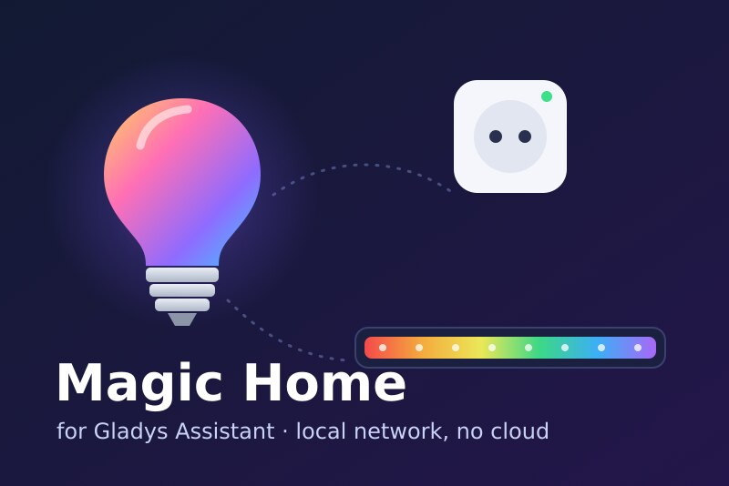
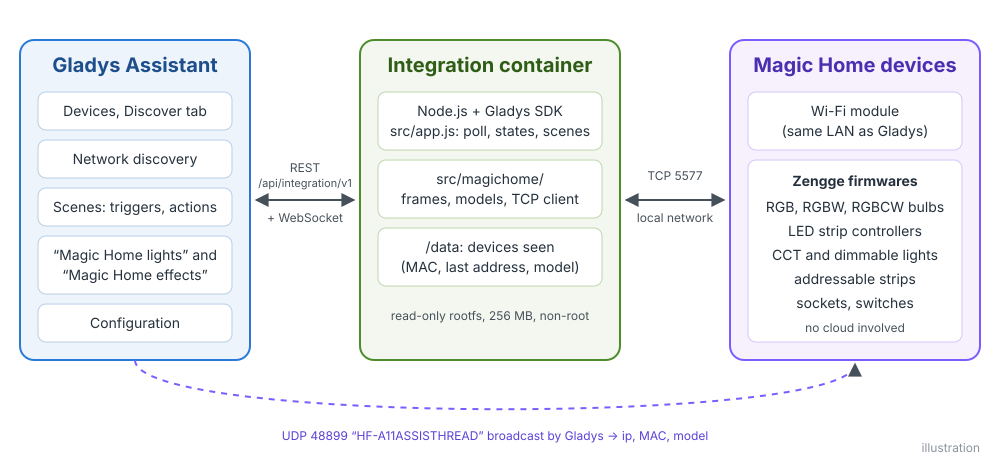
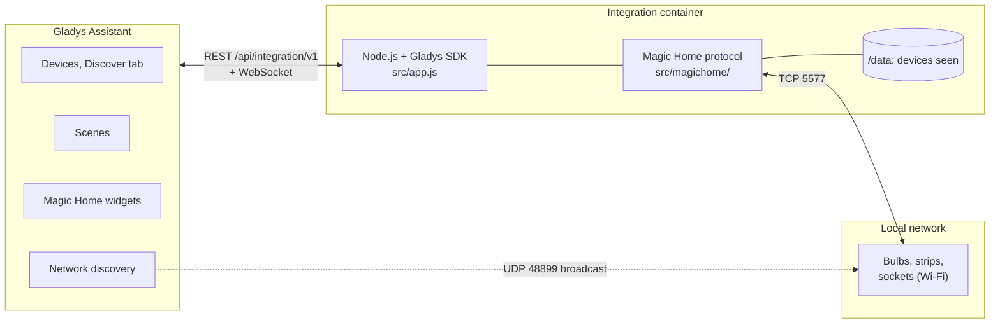
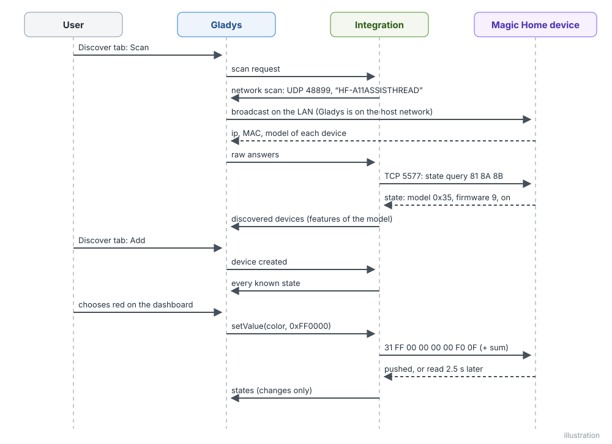
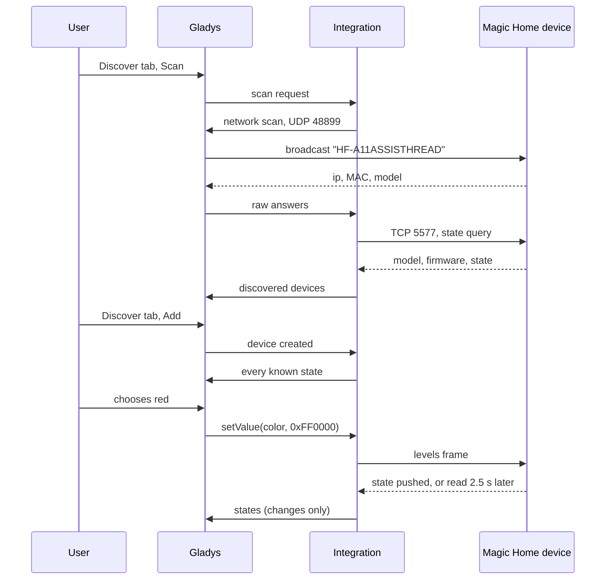
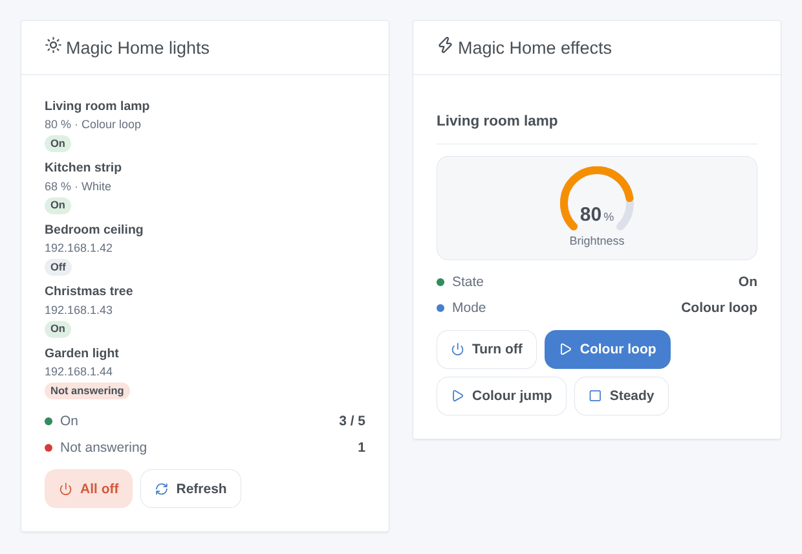
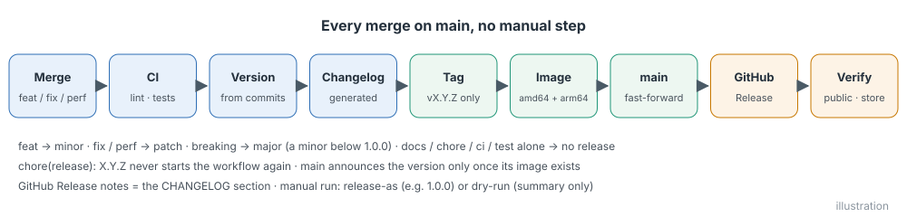

# Magic Home for Gladys Assistant

**English** | [Français](README.fr.md) | [Deutsch](README.de.md) | [Español](README.es.md)

[](LICENSE)
[](https://github.com/William-De71/gladys-magic-home/releases)
[](https://github.com/William-De71/gladys-magic-home/actions/workflows/release.yml)
[](https://gladysassistant.com)



Your Magic Home Wi-Fi bulbs, LED strip controllers and sockets (Zengge firmwares: Magic Home Pro, Zengge, Surplife apps) in Gladys Assistant, controlled on your local network with no account and no cloud. Colours, whites, brightness and built-in effects, on the dashboard and in the scenes.

## Features

- **Discovery** on the local network, without any account: the UDP search of the Magic Home app (port 48899) goes through the network discovery of Gladys; IP addresses can be typed for the devices it cannot reach. Each device is identified by its MAC address and found again after an address change.
- **Lights** in the Discover tab with the features their model and wiring offer: on/off, brightness, colour, colour temperature. Bulbs, RGB / RGBW / RGBWW / CCT / single-colour controllers, CCT bulbs, addressable strips, Christmas lights.
- **Sockets and switches** as on/off switches.
- **Every protocol generation**: the original one, the 8- and 9-byte checksum protocols, the 25-byte HSV firmware of the newest bulbs, the wrapped frames of addressable strips and table lamps.
- **States** read every 10 s to 1 min over one connection per device, plus the changes the devices report on their own (remote control, Magic Home app), with a local / unreachable badge per device.
- **Two dashboard widgets**: "Magic Home lights" (every device) and "Magic Home effects" (one light and three effect buttons).
- **Two scene triggers** (a device stops answering, answers again) and **four scene actions** (built-in effect, custom colours, flash, stop the effect).
- English, French, German and Spanish.

## How it works





The integration container sits behind the Docker bridge, where a broadcast never reaches the network: Gladys, on the host network, broadcasts the search datagram the integration forges and relays the answers (`ip, MAC, model`). The integration then opens one TCP connection per device on port 5577, reads its state, and learns its model and firmware from it, hence its protocol and its features.





### Devices and features

| Device                                                                    | Features (category / type)                                        |
| ------------------------------------------------------------------------- | ----------------------------------------------------------------- |
| RGBCW bulbs, floor and ceiling lights (colour or white)                   | On/Off, Brightness (%), Colour, Colour temperature (`light`)      |
| RGB&CCT and RGB/CCT controllers                                           | On/Off, Brightness, Colour, Colour temperature                    |
| RGB, RGBW, RGB/W controllers and bulbs, addressable strips, string lights | On/Off, Brightness, Colour (a white colour lights the white LEDs) |
| CCT bulbs and controllers                                                 | On/Off, Brightness, Colour temperature                            |
| Single-colour controllers and dimmable bulbs                              | On/Off, Brightness                                                |
| Sockets and switches                                                      | On/Off (`switch` / `binary`)                                      |

The colour temperature is in mired (154 = 6500 K, 370 = 2700 K), the scale of the Gladys slider. Device external id: `ext:<selector>:device:<MAC address>` (`ip-<address>` for a device typed in the configuration that never answered the search); features: `…:power`, `…:brightness`, `…:color`, `…:temperature`.

## Transport

`transports: ["local"]`: everything stays on your local network, nothing leaves it and no account is needed. Each device shows a **local** badge, or **unreachable** when it stops answering (unplugged, switched off at the wall, out of Wi-Fi). There is no cloud channel, so no "Prefer the local connection" button. The remote access of the Magic Home app keeps working alongside: the integration never changes it.

## Widgets



- **Magic Home lights**: how many devices are on and how many do not answer, every device with its state badge, its brightness and what it plays (colour, white, effect name) or its address, an **All off** button (with confirmation) and **Refresh**. Setting: all devices or only those on.
- **Magic Home effects**: one light chosen in the settings: state, mode, a brightness gauge, an on/off button and three effect buttons chosen in the settings (with a common speed); while an effect plays, the third button becomes **Steady**.

The images are generated by `docs/illustrations/render.sh` from the real widget code: they are illustrations, not screenshots.

## Scene triggers and actions

| Trigger         | Filters | Variables           |
| --------------- | ------- | ------------------- |
| `light_offline` | device  | `device_name`, `ip` |
| `light_online`  | device  | `device_name`, `ip` |

`light_offline` fires when a device has not answered for 30 seconds (a short outage fires nothing); `light_online` when it answers again after a `light_offline`.

| Action          | Fields                                                    |
| --------------- | --------------------------------------------------------- |
| `start_effect`  | device, effect (23 built-in effects), speed, brightness   |
| `custom_effect` | device, colours (`#RRGGBB`, up to 16), transition, speed  |
| `flash`         | device, colour, duration (1 to 60 s), then previous state |
| `stop_effect`   | device: back to the last steady colour or white           |

None of them returns outputs, and none can fire a trigger. Examples:

- **Someone rings at the door** → **Flash a Magic Home light** red for 5 s on the living room lamp, which then comes back as it was.
- **The garden light stops answering** (cut at the wall switch) → send "The garden light is off at the switch ({{triggerEvent.data.ip}})".
- Every evening at sunset → turn on the kitchen strip at 40 %, then **Play Magic Home colours** `#FF6A00, #FF0040` in a slow fade on the living room strip.

## Requirements

- Gladys Assistant **5.1.1 or later** (dashboard widgets and scene triggers and actions of integrations; older instances cannot install the integration).
- Devices set up with the Magic Home Pro app (or Zengge, Surplife…), connected to the same network as Gladys; the router must let UDP port 48899 and TCP port 5577 through between them (no guest network, no client isolation).
- A fixed IP address per device in your router is recommended (the integration finds a moved device again, but sooner with a fixed one).

## Installation

- **From the store**: Integrations → search "Magic Home" → Install. Accept the network discovery (UDP port 48899) on the install screen.
- **From the repository URL**: Integrations → Install an integration → paste `https://github.com/William-De71/gladys-magic-home`.
- **Developer mode**: Integrations → Install an integration → Developer mode, with the manifest of a build (the summary of the "Build and publish image" workflow prints it).

## Configuration

| Field             | Type   | Default | Meaning                                                               |
| ----------------- | ------ | ------- | --------------------------------------------------------------------- |
| `hosts`           | string | empty   | IP addresses of devices the search does not find, separated by commas |
| `poll_interval`   | select | `30`    | state refresh in seconds: `10`, `30`, `60`                            |
| `rescan_interval` | select | `60`    | automatic search in minutes: `0` (off), `15`, `60`                    |
| `language`        | select | `en`    | language of the feature names and of the scene error messages         |

Button of the configuration page: **Search and test the devices** (searches the network and lists every device with its address, its model and whether it answers).

## Usage

1. Install the integration, then press **Search and test the devices** on its configuration page.
2. Add the devices from the **Discover** tab, and rename them as you like.
3. Add the widgets to a dashboard, create your scenes.

The user documentation is in [docs/en.md](docs/en.md) ([fr](docs/fr.md), [de](docs/de.md), [es](docs/es.md)).

## Limits

- Written from the open-source [flux_led](https://github.com/lightinglibs/flux_led) library documentation of the protocol (used by the Home Assistant "Magic Home" integration), and tested against devices simulated byte for byte, **not yet against real devices**: feedback welcome.
- Effects: the 20 built-in effects of the RGB controllers and bulbs (and 3 more on recent firmwares) and custom colour loops. The hundreds of animations of addressable strips and Christmas lights, the music mode, timers, zones and the strip settings (number of LEDs, IC type, wiring) are not handled: use the Magic Home app for them.
- The brightness of an effect is only settable on firmwares with dimmable effects; the others play effects at full brightness.
- A colour and a white are alternatives: the integration lights one group of LEDs at a time, like the app does on bulbs. A grey colour sent to an RGB+W device lights its white LEDs.
- Multi-channel switches (2 or 4 outlets) are seen as a single switch.
- Devices only reachable through the cloud of the Magic Home app are not supported.

## Local development

```bash
npm install
GLADYS_HOST_API_URL=http://localhost:1443 \
  GLADYS_INTEGRATION_TOKEN=… GLADYS_INTEGRATION_SELECTOR=… \
  MAGICHOME_DATA_DIR=./data DEBUG=gladys-integration-sdk node index.js
```

| Variable                                                                         | Default       | Use                                       |
| -------------------------------------------------------------------------------- | ------------- | ----------------------------------------- |
| `GLADYS_HOST_API_URL`, `GLADYS_INTEGRATION_TOKEN`, `GLADYS_INTEGRATION_SELECTOR` | set by Gladys | connection to the Gladys host API         |
| `MAGICHOME_DATA_DIR`                                                             | `/data`       | folder of `devices.json`                  |
| `DEBUG`                                                                          | unset         | `gladys-integration-sdk` for the SDK logs |

| Script                            | What it does                            |
| --------------------------------- | --------------------------------------- |
| `npm test`                        | the tests (`node --test`), no network   |
| `npm run lint`                    | ESLint                                  |
| `npm run format` / `format:check` | Prettier                                |
| `docs/illustrations/render.sh`    | regenerate the widget illustrations     |
| `scripts/build-cover.sh`          | regenerate `cover.jpg` from `cover.svg` |

## Tests

`npm test` runs the whole integration against the fake Gladys of the SDK and simulated Magic Home devices answering the real frames (RGBCW bulb, CCT bulb, socket, RGB controller, legacy controller, 25-byte bulb): discovery by broadcast and by address, protocol detection, states, commands and their exact frames, pushed states, scene triggers and actions, widgets validated by `validateWidgetContent`, address changes and restarts. The frame builders and parsers are checked against frames captured from real devices. Every model is checked against the rules of the Gladys core and a discovery baseline (external ids are forever), the manifest against the code, the translations and the release script. The CI also builds the image and starts it like Gladys does (read-only, 256 MB, no network).

## Release process

Every merge on `main` publishes a release when its commits deserve one, with no manual step:

```mermaid
flowchart LR
  A[merge on main] --> B[CI: Prettier, ESLint,<br/>tests, Docker build]
  B --> C[next version from<br/>Conventional Commits]
  C --> D[CHANGELOG.md section]
  D --> E[commit chore release<br/>+ tag vX.Y.Z]
  E --> F[image :X.Y.Z + :latest<br/>amd64 + arm64]
  F --> G[main moves to<br/>the release commit]
  G --> H[GitHub Release]
  H --> I[verify: anonymous pull,<br/>store validator, topic]
```





- `feat` → minor, `fix` / `perf` → patch, `!` or `BREAKING CHANGE:` → major (a minor below 1.0.0). `docs`, `chore`, `ci`, `test`, `style`, `refactor`, `build` alone publish nothing.
- The pull request title becomes the squash commit, hence the changelog line: write it in English, for the user (`feat(effects): …`). `pr-title.yml` checks it. Never edit `CHANGELOG.md` by hand.
- The image exists before `main` announces its version (the store indexes `main`).
- 1.0.0 is a manual decision: Actions → Release → Run workflow, `release-as: 1.0.0`. `dry-run` shows the version and the changelog without publishing.
- **Protected `main`**: the release pushes a commit to `main`. With a branch protection or a ruleset, allow GitHub Actions to bypass it (or use a GitHub App), otherwise the release stops after the image.
- After the first release, make the package public: Package settings → Change visibility → Public.

## Troubleshooting

- **No device found**: check that the device answers in the Magic Home app over Wi-Fi (not only through the cloud), that it is on the same network as Gladys, and that the router does not isolate Wi-Fi clients. Otherwise type its IP address in the configuration.
- **"Gladys refused the network discovery"**: reinstall the integration and accept its network access on the install screen.
- **A device is "Not answering"**: it is unplugged, cut at the wall switch or out of Wi-Fi. If its address changed, the next search finds it again (automatic, or **Search and test the devices**).
- **A feature is missing or wrong**: features follow the model and the wiring reported by the device; open an issue with the `MAGICHOME_MODEL` device parameter and the logs.
- Logs: the Logs tab of the integration; `DEBUG=gladys-integration-sdk` for the SDK details.

## Contributing

Issues and pull requests are welcome. Run `npm run format:check`, `npm run lint` and `npm test`, write the pull request title as a Conventional Commit, and run `docs/illustrations/render.sh` after any change to a widget content. A new model goes in `src/magichome/models.js`; it must not change the features of an existing one (`test/fixtures/discovery.baseline.json`).

## Security

See [SECURITY.md](SECURITY.md). No account, no password and no token: the integration only talks to the devices of your local network. `/data` holds the address and the model of each device seen.

## License

[Apache License 2.0](LICENSE), see also [NOTICE](NOTICE). The protocol is implemented for this project, with the [flux_led](https://github.com/lightinglibs/flux_led) library as its documentation. Magic Home, Zengge and Surplife are trademarks of their owners; this project is not affiliated with, endorsed or supported by them.
